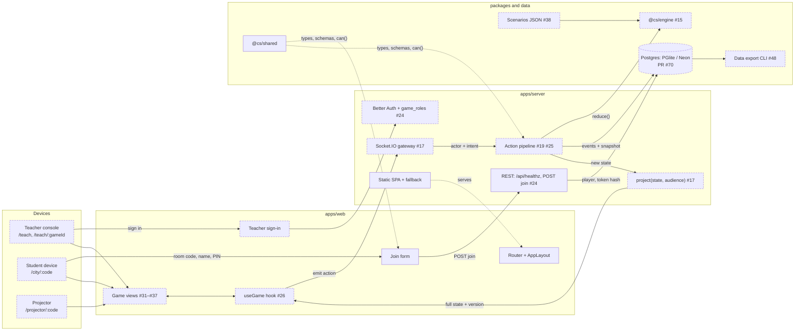
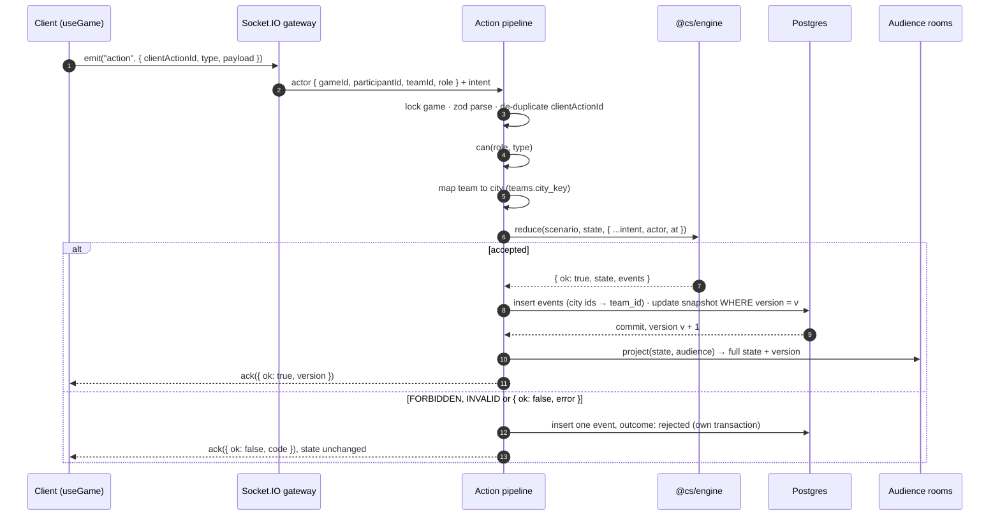
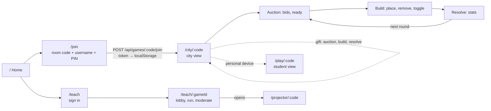
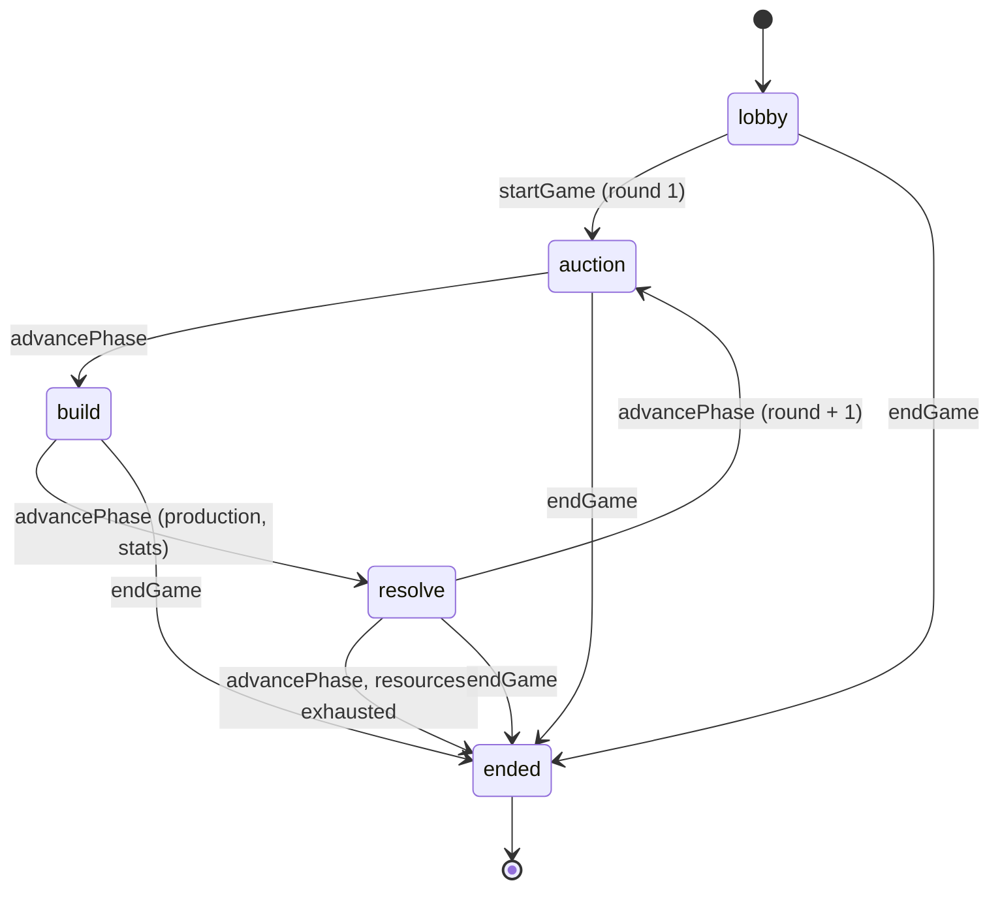

# Interactions

| Field         | Value                                                                                                        |
| ------------- | ------------------------------------------------------------------------------------------------------------ |
| Status        | Active                                                                                                       |
| Applies to    | Whole system                                                                                                 |
| Last reviewed | 2026-11-01                                                                                                   |
| Related       | [`ARCHITECTURE.md`](ARCHITECTURE.md), [`GAME-RULES.md`](GAME-RULES.md), [`REQUIREMENTS.md`](REQUIREMENTS.md) |

## 1. Scope

Diagrams of how components, screens and game phases connect. They illustrate
the normative documents and add no requirements of their own. When a diagram
and a specification disagree, the specification wins and the diagram is a
bug.

Mermaid source below is canonical. An interactive version with per-component
details and issue links is in
[`diagrams/system-map.html`](diagrams/system-map.html); open it in a browser
from a local checkout and keep it in sync (SPEC-GUIDELINES §8).

Legend: solid nodes are implemented on `main`; dashed nodes are planned or in
review. Issue numbers name the tracking issue.

## 2. Components

## 3. Action round trip

One player action, end to end (ARCHITECTURE §4).

## 4. Screen flow

## 5. Game lifecycle

`pauseGame` and `resumeGame` toggle the `paused` flag in `auction`, `build`
or `resolve` without changing the phase.

## 6. Responsibilities by phase

| Actor     | Lobby                                   | Auction                           | Build                                | Resolve                              | Ended                |
| --------- | --------------------------------------- | --------------------------------- | ------------------------------------ | ------------------------------------ | -------------------- |
| Teacher   | Assign teams; rename, kick, lock; start | Watch ready-up; advance, pause    | Advance, pause                       | Review stats; advance, pause         | Export the log (#48) |
| Player    | Join and wait                           | Change sealed bids; set ready     | Place, remove, toggle buildings      | View production and stats            | View final stats     |
| Gifts     | —                                       | Any player, no approval           | Any player, no approval              | Any player, no approval              | —                    |
| Projector | Room code, joined teams                 | Lots, ready count; no bid amounts | World map                            | City stats side by side              | Final results        |
| Engine    | Load scenario, seed RNG                 | Draw lots; resolve bids and ties  | Placement, adjacency, employment cap | Production, stats, nature, snapshot  | —                    |
| Events    | `teacher.*`, `game.started`             | `auction.*`                       | `building.*`                         | `production.building_ran`, `round.*` | `game.ended`         |

`trade.gift_sent`, `phase.advanced`, `game.paused` and `game.resumed` can
occur in `auction`, `build` and `resolve`.
